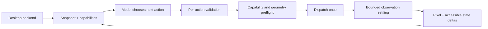

# Computer Use in Studio

This branch bundles the desktop engine (implementation version 1.2.0) directly.
Do not run the old standalone installer over this checkout: runtime and provider
integration are maintained here together.

## Update

Close Daena/Studio before updating this branch. From your Daena Git checkout:

```bash
git switch feat/studio-conversation-redesign
git pull --ff-only origin feat/studio-conversation-redesign
python -m pip install -e '.[desktop,ollama,openrouter,gemini,web]'
python -c 'from src.tools.builtin.computer_use import __version__; print(__version__)'
daena-studio
```

The version check should print `1.2.0`. Existing workspace tool permissions still
apply: enable `computer_use` (and `tool_search` when using lazy tool discovery).
The configured model must support image input. No model credentials are bundled.

## Native backend

The primary backend needs the external `cua-driver` executable in the logged-in
desktop session. It is not included in the Python package. Diagnose it with:

```bash
cua-driver doctor
python -m src.tools.builtin.computer_use doctor
```

Optional X11 support: install `.[computer-x11]` plus the system `xdotool` package,
then set `DAENA_COMPUTER_BACKEND=x11`. X11 requires explicit foreground input,
does not provide accessibility controls, and does not control native Wayland
surfaces. Cua support depends on the installed driver/backend. Unsupported
capabilities produce errors rather than claiming an event was sent.

X11 Unicode typing reserves distinct unused keycodes and waits for the target's
standard EWMH `_NET_WM_PING` acknowledgement before restoring the keyboard map.
This avoids libxdo's temporary-keycode reuse race with Qt/XKB clients. A target
that lacks this protocol (or a keyboard map without spare codes) reports an
explicit unsupported-text error for unmapped characters; use browser DOM input
or Cua native text input on such surfaces. The clipboard is not modified. Native
tests cover mixed scripts/emoji across batches and exact keymap restoration.

## Observation and action

Capture the intended window from `list_windows`, then use its returned
`snapshot_id` for input. Every delivered or uncertain input consumes that frame
and normally returns the next observation. Use that next ID, rather than
recapturing after every successful tool call. A new target with omitted delivery mode selects the backend’s advertised preferred
mode (foreground for Cua and X11). An explicit choice persists for the same
session/window. Timeouts and partial typing never replay.
A structured zero-delivery refusal keeps the snapshot usable for a deliberately
corrected call; it never automatically switches input mode.

Choose an opaque element ID, a unique exact label/role, or a visible native pixel
coordinate. Ambiguity returns candidate IDs. `inspect` with query/offset pages
through the existing snapshot without another screenshot. `zoom` retains its
origin/scale mapping; zoom pixels are not native input coordinates.

For browser navigation, select/capture the browser and use:

```json
{"action":"navigate","snapshot_id":"<current ID>","url":"https://example.org","delivery_mode":"foreground"}
```

This sends Ctrl+L, the literal URL, and Enter. It does not prove a page loaded.
For normal text editing, `type` targets the focused field or an explicitly selected
control. `key` supports shortcuts. Pointer actions include click/double/right/
middle click, scroll and drag; pointer move is available on X11 and explicitly
unsupported by the current Cua adapter. `expect` specifies an observable condition
to poll after input. Delivery, pixel change and task completion remain distinct.

## Context

The last known frame, focus/value information, input receipt, coordinate frame
and snapshot validity are pinned together while the desktop tool is active.
Inspection or errors do not erase vision. A new observation replaces the old
image; session/workspace changes cannot reuse another session's frame. Disk
artifacts are referenced from history; base64 images are never stored in STM or
fed to the historical summarizer. Expired/consumed frames are labeled explicitly.

Screenshots are attached **before** conversation budgeting, uniformly across
Ollama, OpenRouter and Gemini. Studio Settings → Context & memory exposes
`Tokens per screenshot · estimate` (`context.image_token_reserve`, default 4096).
This is a configurable allowance, not a tokenizer measurement; actual costs vary
by provider and model. Image bytes are not counted as text, and multimodal usage
does not distort text-token calibration. If essential instructions plus the
current observation cannot fit, the runtime reports a budget error instead of
silently dropping the screenshot. Structured tool receipts remain valid JSON
through pruning; complete assistant/tool exchanges stay paired.

## Validation and limits

On 2026-10-23, Python 3.12: 343 tests passed with the native desktop test enabled.
This includes a real Qt application on an isolated X11 display receiving focus,
Unicode typing, checkbox/save clicks, drag, scroll and a browser-style address
shortcut/type/Enter sequence. The fixture records actual received UI events.
The complete Agent-loop test uses a scripted model to check tool discovery,
mode continuity, current images, receipts and history isolation. Provider tests
check real message serializers. These are not live vision-model benchmarks.
Static checks, compilation and the distribution build passed. An installed wheel
was exercised outside the source checkout: Studio created and read a file through
its worker, rendered the response, and discovered Computer Use 1.1.0.

The user's Firefox, live Cua/Wayland session, and remote model inference are not
available in this environment. The tests do not establish support for every
application or guarantee that only model limitations remain. Human/OS changes
outside cooperating agents are not fully tracked by snapshot revisions.

The branch also contained unresolved merge markers in Studio/apply_patch and an
invalid ToolManager indentation. Those were resolved, preserving patch replay,
unique-match editing and atomic rollback. No website-specific targeting rules or
arbitrary repeated-click lockouts were added.

```bash
python -m pip install -e '.[dev,desktop,computer-x11,ollama,openrouter,gemini,web]'
DAENA_TEST_DESKTOP=1 xvfb-run -a python -m pytest -q tests
python -m ruff check src cli harness tests
python -m compileall -q src cli harness tests examples
python -m build
```

### Pointer input on surfaces without accessibility labels

A canvas or other custom widget may have no accessible name. Use points from the
current screenshot; a missing label is not evidence that pointer input is
unsupported. Window screenshots use coordinates relative to their top-left,
without adding the window's desktop position. `drag` takes `from_coordinate` and
`to_coordinate` in those native pixels and holds the mouse button between them.
Choose `delivery_mode="foreground"` for native pointer input when the backend
cannot deliver it in the background. Delivery never changes automatically.

`position={"x": 100, "y": 120}` is an alternative to `coordinate=[100,120]` for
pointer actions. Without a selector it is an absolute screenshot point. With an
explicit target or element, it is an offset inside that control's observed
bounds. Missing targets, unavailable bounds, out-of-range offsets, and combining
`position` with `coordinate` are rejected before dispatch. Exact opaque IDs can
also be supplied as `target={"id": "<observed ID>"}`; stale IDs remain invalid.

The current screenshot and control list remain attached to model requests.
Historical input receipts preserve the action outcome and resulting observation
identity without repeating old control lists. This does not infer successful
completion of a drawing or any application workflow.

X11 pointer movement uses XTest with a server acknowledgement, including when
moving to the cursor's existing position. Consecutive strokes no longer wait for
a movement event that cannot occur. Post-input observations preserve `vision`
mode unless another mode or an accessibility postcondition is requested.

### X11 discovery diagnostics

Window discovery falls back to walking reparented client windows when the window
manager does not publish a usable EWMH client list. If a client omits
`_NET_WM_PID`, XRes can supply its actual local process identity. Clients without
verifiable identity remain excluded, with a count in `window_diagnostics`.
Discovery and screenshots need python-xlib and a connected display; missing
xdotool blocks input before dispatch, without blocking these observations.

An empty X11 list means no eligible X11 clients were found, not that an app is
uninstalled. Native Wayland windows can be invisible to an X11 connection;
`doctor` reports the session type and Wayland-display presence. In that case use
a supported native backend or an X11 desktop session. The `desktop-control`
builtin skill describes discovery, identity selection, input and verification
without assuming an application's executable name or installation path.

### Native Wayland is a host capability boundary

`DAENA_COMPUTER_BACKEND=x11` selects the X11 adapter; it does not switch a Wayland
login session into Xorg. In a Wayland session, `DISPLAY` normally points at
Xwayland, which exposes only X11 clients. Native Wayland windows remain outside
this backend's control. An empty inventory now reports
`native_wayland_unavailable` with `retry_requires_setup_change`, rather than
suggesting the user's application is missing. Whole-desktop capture is rejected
because an Xwayland root image is not the Wayland compositor's desktop.
Explicitly selected Xwayland clients remain usable.

For the tested native X11 path, save your work, log out, choose an X11/Xorg
session in the login screen if your desktop provides one, then restart Daena.
Check `XDG_SESSION_TYPE` in that session. Alternatively use a native backend
that explicitly supports your compositor; this update does not implement a
Wayland RemoteDesktop portal backend. The model should report this limitation
instead of installing replacement applications or inventing terminal commands.


## 1.2 controller refactor

The controller keeps model planning separate from validated native primitives:



- **Action contracts:** `interact` is a category, not an executable action. Use
  `click`, `type`, `key`, `drag`, etc. Fields unrelated to a primitive are rejected
  before input, so a stray coordinate on a keyboard action cannot move the pointer.
- **Capability selection:** capture advertises delivery modes, pointer support,
  continuous-path support and platform scope. For a new target the omitted mode
  uses the backend preference, normally foreground. An explicit background request
  is honored or refused; refusal never triggers automatic foreground replay.
- **Feedback:** the pinned receipt retains the prior input target, next snapshot
  ID, pixel changes, and accessible focus/value/checked/selected changes. Typed
  text is represented by character count in the target receipt; protected control
  values remain redacted. Delivery and observable changes do not establish goals.
- **Settling:** ordinary input now observes until the screen/AX state stays quiet
  for a short interval, using a polling deadline of `settle_seconds` (default 1.2 seconds). Native
  captures can take longer; the enclosing operation timeout also applies. Animation
  returns the latest frame with a deadline marker. `seconds` selects an explicit
  single delay; `expect` polls the requested accessible condition. None replays
  the original input, and quietness does not establish application readiness.
- **Drawing:** X11 supports `drag(path=[[x,y], ...], ...)`, two to 256 native
  points forming one continuous held-button gesture. Every vertex is validated
  first; cancellation and uncertain button presses attempt release in `finally`.
  Release failure is reported explicitly. The current Cua adapter advertises only
  endpoint drag and refuses paths before sending input.
- **Image grounding:** full images and zoom crops carry a verified mapping to
  native input coordinates. Budget reduction preserves fixed coordinate arrays,
  frame identity, image references and essential receipt information.

Example on a backend declaring `drag_path=true`:

```json
{"action":"drag","snapshot_id":"<observed ID>","path":[[80,100],[140,40],[200,100],[200,200],[80,200],[80,100]],"duration_ms":800}
```

Windows/macOS driver startup no longer imposes Linux DISPLAY/XDG requirements.
Those code paths are tested with platform mocks, not live Windows/macOS desktops.
Native Wayland support still depends on the installed Cua driver; the optional
X11 adapter cannot control native Wayland windows.

### Design references

The review used primary implementations rather than an application-specific
workflow script:

- [OpenAI CUA sample loop](https://github.com/openai/openai-cua-sample-app/blob/main/python-app/app/responses_loop.py): correlated model/tool exchange and screenshots after execution.
- [Anthropic computer tool](https://github.com/anthropics/anthropic-quickstarts/blob/main/computer-use-demo/computer_use_demo/tools/computer.py): explicit coordinate transforms, action primitives and observation delay.
- [Microsoft UFO action execution](https://github.com/microsoft/UFO/blob/main/ufo/automator/action_execution.py) and [receivers](https://github.com/microsoft/UFO/blob/main/ufo/automator/puppeteer.py): backend separation, control identity and capability validation.
- [Microsoft OmniParser](https://github.com/microsoft/OmniParser): visual grounding is a distinct optional model layer; it does not resolve OS input delivery limits and is not a required Daena dependency.

The regression suite exercises delayed/animated observations, invalid actions,
focus/value feedback, provider coordinate maps, negative driver replies,
foreground selection, gesture cancellation/release and the real Qt/X11 canvas.
It is not a live model benchmark or a guarantee of control over every application.
